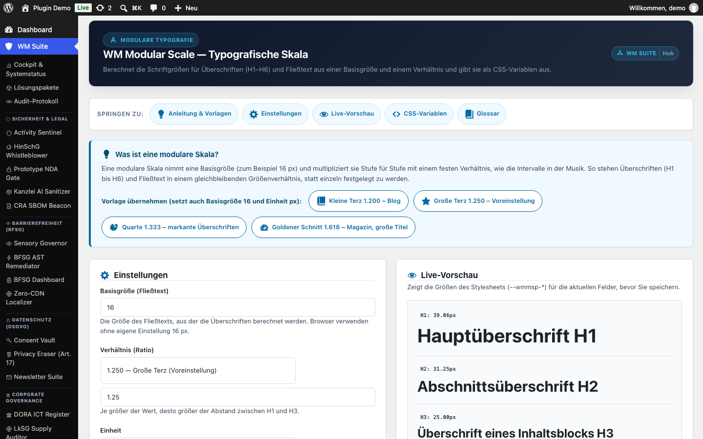
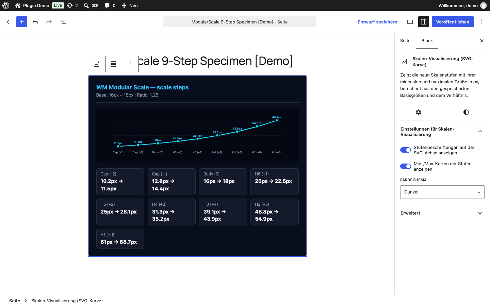
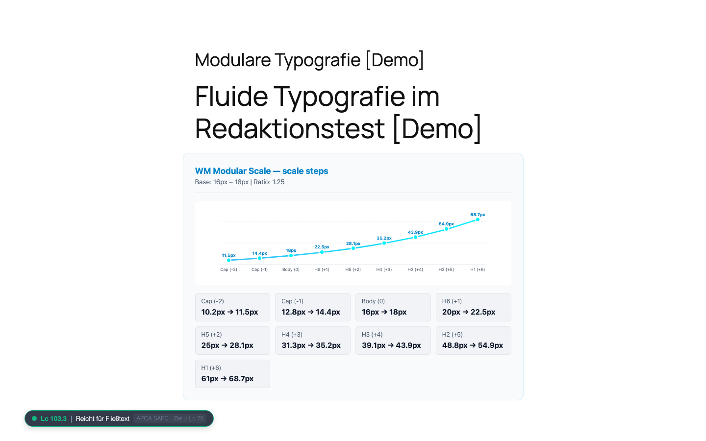
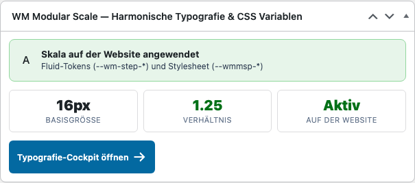

# WM Modular Scale (Deutsche Dokumentation)

<p align="center">
  <a href="README.md"></a>
  <a href="README.de.md"></a>
  <a href="README.es.md"></a>
</p>

> **Typografischer Skalen-Rechner, Generator fluider `clamp()`-Tokens und Typografie-Brücke zu Gutenberg, GeneratePress und GenerateBlocks**  
> **Plugin-Seite:** [https://arnoldwender.com/wordpress-plugins/wm-modularscale/](https://arnoldwender.com/wordpress-plugins/wm-modularscale/)  
> **Mit einem agentischen Workflow entwickelt:** entstanden mit KI-Coding-Agenten. Prüfen und testen Sie es wie jeden fremden Code, bevor Sie es produktiv einsetzen.  
> **Support & Haftung:** Kein Support (Zero Support) — reproduzierbare Bugs ausschließlich über [GitHub Issues](https://github.com/arnoldwender/wm-wp-modularscale/issues) · kein privater Support · OHNE GEWÄHR („AS IS“) / keine Haftung ([SUPPORT.md](SUPPORT.md))

> Diese Datei beschreibt, was das Plugin tatsächlich ausliefert. Bis zum 2026-09-14 nannte sie nicht ausgelieferte CLI-Unterbefehle, eigene REST-Routen, einen Frontend-Shortcode und Prüfexporte; nichts davon existiert in diesem Repository (gemessen: kein `WP_CLI::add_command`, `register_rest_route`, `add_shortcode` oder `dbDelta`). Das Plugin speichert elf Optionen und gibt CSS aus.

---

## Live-Vorschau

!WM Modular Scale Banner

| Einstellungen & Sandbox | Block-Editor | Frontend-Blöcke | Dashboard-Widget |
|---|---|---|---|
|  |  |  |  |

---

## Was das Plugin leistet

1. **Modulare Skala berechnen:** eine Basisgröße, ein Verhältnis (Major Second 1,125 … Goldener Schnitt 1,618 oder frei, filterbar über `wm_modularscale_ratios`), neun Stufen von −2 (Mikro-Beschriftung) bis +6 (Hero).
2. **Fluide CSS-Tokens im `<head>`**, wenn *auf die Website anwenden* aktiv ist: `@property`-Deklarationen und ein `:root`-Block mit `--wm-step-neg-2 … --wm-step-6` sowie `--ms-neg-2 … --ms-6` als `clamp()` zwischen den konfigurierten Viewports (Standard 360 px → 1440 px), passenden Zeilenhöhen `--wm-lh-*`, semantischen Aliassen (`--wm-font-size-h1 … body`), GeneratePress-Aliassen (`--gp-font-size-*`), den Hilfsklassen `.has-fluid-h1-font-size … .has-fluid-body-font-size` und `.wm-fluid-container`. Jede Stufe wird auf WCAG 1.4.4 Zoom-Sicherheit geprüft (max ≤ 2,5 × min). Optionaler Anti-CLS-`@font-face`-Fallback (Inter → Arial u. a.).
3. **Optionales Legacy-Stylesheet:** der Schalter *anwenden* lädt zusätzlich `wm-modularscale.css`, das `body`, `h1`–`h6` und Absätze aus `--wmmsp-*`-Variablen (Basis, Verhältnis, Einheit, Präzision) dimensioniert. Keine Viewport-Regel verkleinert die eingestellte Basisgröße (Standard 16 px); ein Minimum erzwingt das Plugin nicht, das Feld nimmt jeden Wert ab 1.
4. **Sieben Gutenberg-Blöcke mit kompilierten Sidebar-Bedienelementen (`build/index.js`)** in der Kategorie „WM Modular Scale“ (`wm-scale/*`): Fluid Heading, Fluid Lead Text, Fluid Container (`@container`), Typographic Grid (CSS-Raster mit Abstand aus der Skala), Ratio Visualizer (neun Stufen, Hell-/Dunkel-Darstellung, optionale Stufenkarten), APCA Contrast Badge (Lc eines Farbpaars nach apca-w3 0.1.9 mit wählbarer Zielrolle; APCA ist nicht Teil der WCAG), Theme.json Exporter (`both`, `json` oder `tailwind`).
5. **theme.json-Brücke:** Filter `wp_theme_json_data_theme` — `settings.typography.fontSizes` werden die neun fluiden Stufen, `defaultFontSizes: false`, `fluid: true`.
6. **GeneratePress-Brücke:** leert die Google-Fonts-Liste und blendet sie im Font Manager aus, entfernt `generate-fonts`, hängt `--gp-font-size-*` und `h1`–`h6`-Regeln an das dynamische Typografie-CSS an und listet Inter, Outfit, Cinzel, Cabinet Grotesk und einen System-Stack in den Schriftauswahlen (das Plugin liefert keine Schriftdateien; die Namen greifen nur, wenn die Website sie bereitstellt).
7. **GenerateBlocks 1.x & 2.x + WordPress 6.5–6.9 Ökosystem-Brücken:** Global Styles `wm-fluid-h1/h2/h3/body`, Typografie-Presets `wm-step-0 … 6`, `container-type: inline-size` auf Container-Blöcken mit `useContainerQueries`, GenerateBlocks-2.x-Dynamic-Tag `{{wm_scale_token}}`, Block-Bindings-Quelle `wm-modularscale/tokens`, zwei Block-Vorlagen (`wm-modularscale/typographic-specimen`, `wm-modularscale/gb-fluid-hero`) und die WordPress-6.9-Ability `wm-modularscale/compute-scale`.
8. **Backend & Opt-in-Deinstallation:** Einstellungsseite (Menü *Modular Scale*, mit aktivem Hub unter *WM Suite*; zusätzlich *Einstellungen › Modular Scale*) mit Live-Sandbox, Ein-Klick-Presets und Opt-in-Option `wmmsp_delete_data_on_uninstall` (standardmäßig bleiben Einstellungen beim Löschen des Plugins erhalten); Dashboard-Widget auf den Admin-Stylesheets der WM-Suite-Familie; vollständige Übersetzungen (`.po`, `.mo`, Gutenberg JED `.json`) in allen 28 Sprachpaketen.
9. **WM Suite Hub Spoke:** `includes/class-modularscale-spoke-adapter.php` meldet sich über `wm_register_suite_module` (CycloneDX-1.6-SBOM mit SHA-256 der Hauptdatei, Telemetrie, Aktionen `self_test` / `calculate_scale`).

### Nicht enthalten

Keine WP-CLI-Befehle, keine REST-Endpunkte, keine Shortcodes, keine eigenen Datenbanktabellen, kein Audit-Protokoll oder Export, keine externen Anfragen.

---

## Schnellstart

1. Plugin installieren und aktivieren (WordPress 6.4+, PHP 8.1+).
2. **Modular Scale** im Admin-Menü öffnen (**WM Suite › Modular Scale** mit Hub).
3. Verhältnis-Preset wählen oder Wert eintippen, Basisgröße, Einheit und Präzision setzen, Sandbox prüfen, *Skala auf der Website anwenden* aktivieren, speichern.
4. Im Editor die sieben Blöcke aus *WM Modular Scale* (inklusive `InspectorControls`), die Block-Vorlagen, `wm-modularscale/tokens` oder `{{wm_scale_token}}` und `--ms-*` in GenerateBlocks nutzen.

Optionen, Hooks, Klassen und bekannte Abweichungen: **[README.md](README.md)** (Referenz) und **[DEVELOPERS.md](DEVELOPERS.md)**.

```bash
php tests/test-suite.php        # Standalone-Prüfungen ohne WordPress
bash tests/run-mutations.sh     # jede rückgängig gemachte Korrektur muss die Suite rot machen
npm run build && npm test       # Editor-Bundle bauen + Vitest ausführen
```

---

## Datenschutz und Barrierefreiheit

- **Keine externen Anfragen:** kein CDN, keine Google Fonts (die GeneratePress-Brücke entfernt sie), keine Telemetrie an Dritte.
- **Barrierefreiheit:** die eingestellte Basisgröße (Standard 16 px) gilt auf jedem Viewport, jede fluide Stufe wird gegen WCAG 1.4.4 (Zoom, max ≤ 2,5 × min) geprüft, der APCA-Block zeigt den Lc-Wert eines Farbpaars. Eine Konformität mit WCAG oder BFSG wird nicht behauptet.
- **Datenschutz:** es werden keine personenbezogenen Daten verarbeitet; das Plugin liest und schreibt nur eigene Optionen und behält sie bei Deinstallation standardmäßig bei, sofern das Löschen nicht explizit aktiviert wurde.

---

## Lizenz

Vertrieben unter der **GNU General Public License v2 oder neuer**.  
Copyright (C) 2026 Arnold Wender.  
