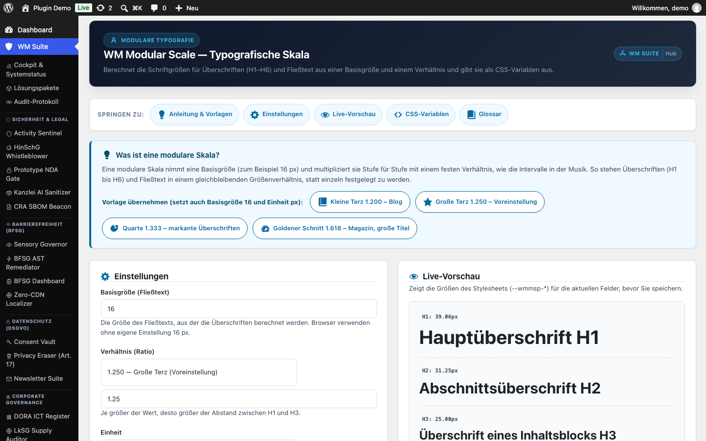
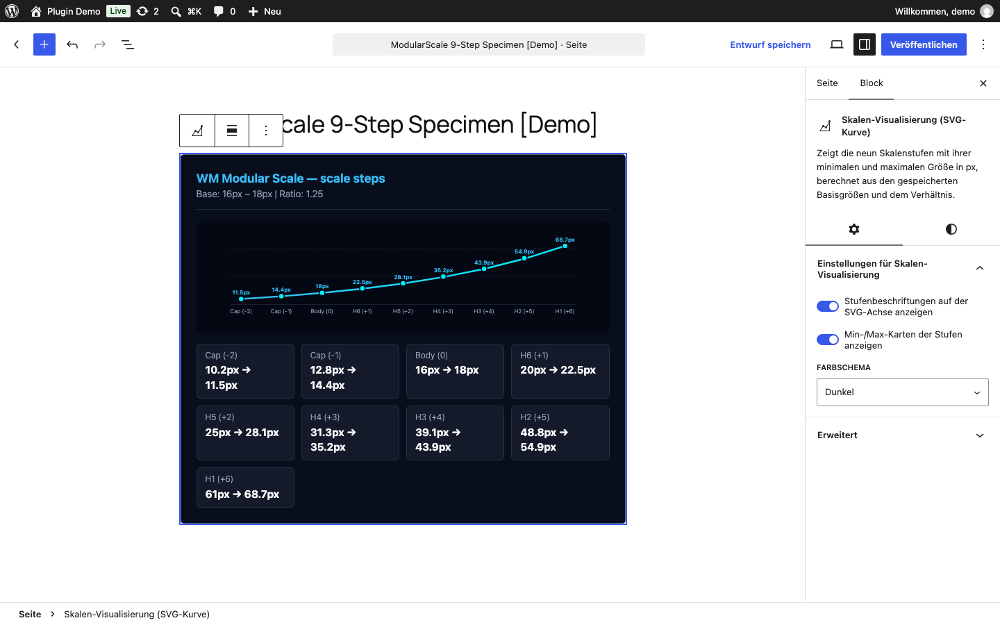
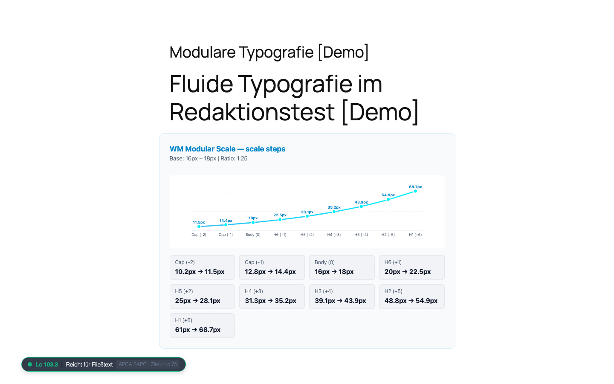
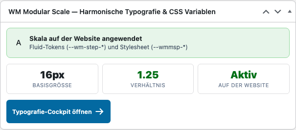

# WM Modular Scale (Documentación en Español)

<p align="center">
  <a href="README.md"></a>
  <a href="README.de.md"></a>
  <a href="README.es.md"></a>
</p>

> **Calculadora de escala tipográfica, generador de tokens `clamp()` fluidos y puente tipográfico para Gutenberg, GeneratePress y GenerateBlocks**  
> **Página del plugin:** [https://arnoldwender.com/es/plugins-wordpress/wm-modularscale/](https://arnoldwender.com/es/plugins-wordpress/wm-modularscale/)  
> **Desarrollado con un agentic workflow:** creado con agentes de programación de IA. Revísalo y pruébalo como cualquier código de terceros antes de usarlo en producción.  
> **Soporte y responsabilidad:** Cero soporte (Zero Support) — errores reproducibles únicamente en [GitHub Issues](https://github.com/arnoldwender/wm-wp-modularscale/issues) · sin soporte privado · TAL CUAL («AS IS») / sin responsabilidad ([SUPPORT.md](SUPPORT.md))

> Este archivo describe lo que el plugin entrega de verdad. Hasta el 2026-09-14 mencionaba subcomandos CLI no incluidos, rutas REST propias, un shortcode de rejilla y exportaciones de auditoría; nada de eso existe en este repositorio (medido: ningún `WP_CLI::add_command`, `register_rest_route`, `add_shortcode` ni `dbDelta`). El plugin guarda once opciones e imprime CSS.

---

## Capturas en vivo

!Banner de WM Modular Scale

| Ajustes y Sandbox | Editor de bloques | Bloques en frontend | Widget del escritorio |
|---|---|---|---|
|  |  |  |  |

---

## Qué hace el plugin

1. **Calcula una escala modular:** un tamaño base, una proporción (Major Second 1.125 … Proporción Áurea 1.618 o un valor libre, filtrable mediante `wm_modularscale_ratios`), nueve pasos de −2 (micro leyenda) a +6 (hero).
2. **Imprime tokens CSS fluidos en `<head>`** cuando *aplicar al sitio* está activo: declaraciones `@property` y un bloque `:root` con `--wm-step-neg-2 … --wm-step-6` y `--ms-neg-2 … --ms-6` como `clamp()` entre los viewports configurados (por defecto 360 px → 1440 px), alturas de línea `--wm-lh-*`, alias semánticos (`--wm-font-size-h1 … body`), alias de GeneratePress (`--gp-font-size-*`), las clases `.has-fluid-h1-font-size … .has-fluid-body-font-size` y `.wm-fluid-container`. Cada paso se comprueba contra la seguridad de zoom WCAG 1.4.4 (máx ≤ 2.5 × mín). Fallback `@font-face` anti-CLS opcional (Inter → Arial, entre otros).
3. **Hoja heredada opcional:** el interruptor *aplicar* también carga `wm-modularscale.css`, que dimensiona `body`, `h1`–`h6` y párrafos a partir de las variables `--wmmsp-*` (base, proporción, unidad, precisión). Ninguna regla de viewport reduce el tamaño base configurado (16 px por defecto); el plugin no impone un mínimo, el campo acepta cualquier valor desde 1.
4. **Siete bloques de Gutenberg con controles compilados de barra lateral (`build/index.js`)** en la categoría «WM Modular Scale» (`wm-scale/*`): Fluid Heading, Fluid Lead Text, Fluid Container (`@container`), Typographic Grid (rejilla CSS con separación de la escala), Ratio Visualizer (los nueve pasos a su tamaño con selector claro/oscuro y tarjetas opcionales), APCA Contrast Badge (Lc de un par de colores según apca-w3 0.1.9 con rol objetivo configurable; APCA no forma parte de las WCAG), Theme.json Exporter (`both`, `json` o `tailwind`).
5. **Puente theme.json:** filtro `wp_theme_json_data_theme`; `settings.typography.fontSizes` pasan a ser los nueve pasos fluidos, `defaultFontSizes: false`, `fluid: true`.
6. **Puente GeneratePress:** vacía la lista de Google Fonts y la oculta en el Font Manager, retira `generate-fonts`, añade `--gp-font-size-*` y reglas `h1`–`h6` al CSS tipográfico dinámico y lista Inter, Outfit, Cinzel, Cabinet Grotesk y una pila del sistema en los selectores (el plugin no incluye archivos de fuentes; esos nombres solo resuelven si el sitio los provee).
7. **Puentes GenerateBlocks 1.x y 2.x + ecosistema WordPress 6.5–6.9:** estilos globales `wm-fluid-h1/h2/h3/body`, presets tipográficos `wm-step-0 … 6`, `container-type: inline-size` en bloques Container con `useContainerQueries`, etiqueta dinámica `{{wm_scale_token}}` para GenerateBlocks 2.x, fuente de Block Bindings `wm-modularscale/tokens`, dos patrones de bloques (`wm-modularscale/typographic-specimen`, `wm-modularscale/gb-fluid-hero`) y la Ability `wm-modularscale/compute-scale` de WordPress 6.9.
8. **Administración y desinstalación opt-in:** página de ajustes (menú *Modular Scale*, o bajo *WM Suite* con el hub activo; también *Ajustes › Modular Scale*) con sandbox en vivo, presets de un clic y opción explícita `wmmsp_delete_data_on_uninstall` (desactivada por defecto para conservar los ajustes al desinstalar salvo confirmación); widget de escritorio sobre las hojas admin de la familia WM Suite; traducciones completas (`.po`, `.mo`, Gutenberg JED `.json`) en los 28 paquetes de idioma incluidos.
9. **Spoke del WM Suite Hub:** `includes/class-modularscale-spoke-adapter.php` se registra por `wm_register_suite_module` (entrada SBOM CycloneDX 1.6 con el SHA-256 del archivo principal, telemetría, acciones `self_test` / `calculate_scale`).

### No incluido

Sin comandos WP-CLI, sin endpoints REST, sin shortcodes, sin tablas propias en la base de datos, sin registro de auditoría ni exportaciones, sin peticiones externas.

---

## Inicio rápido

1. Instala y activa el plugin (WordPress 6.4+, PHP 8.1+).
2. Abre **Modular Scale** en el menú de administración (**WM Suite › Modular Scale** con el hub).
3. Elige un preset de proporción o escribe una, fija tamaño base, unidad y precisión, revisa el sandbox, marca la casilla de aplicación al sitio y guarda.
4. En el editor usa los siete bloques de la categoría *WM Modular Scale* (con `InspectorControls` completos), los patrones incluidos, `wm-modularscale/tokens` o `{{wm_scale_token}}` y `--ms-*` en GenerateBlocks.

Opciones, hooks, clases y desviaciones conocidas: **[README.md](README.md)** (referencia) und **[DEVELOPERS.md](DEVELOPERS.md)**.

```bash
php tests/test-suite.php        # comprobaciones standalone sin WordPress
bash tests/run-mutations.sh     # cada corrección deshecha tiene que poner la suite en rojo
npm run build && npm test       # compila build/index.js + ejecuta vitest
```

---

## Privacidad y accesibilidad

- **Sin peticiones externas:** sin CDN, sin Google Fonts (el puente GeneratePress las retira), sin telemetría a terceros.
- **Accesibilidad:** el tamaño base configurado (16 px por defecto) se mantiene en cualquier viewport, cada paso fluido se comprueba contra WCAG 1.4.4 (zoom, máx ≤ 2.5 × mín), el bloque APCA muestra el Lc de un par de colores. No se afirma conformidad con las WCAG ni con la BFSG.
- **Privacidad:** no se procesan datos personales; el plugin solo lee y escribe sus propias opciones y las conserva al desinstalar salvo que el administrador active el borrado explícito.

---

## Licencia

Distribuido bajo la **GNU General Public License v2 o posterior**.  
Copyright (C) 2026 Arnold Wender.  
