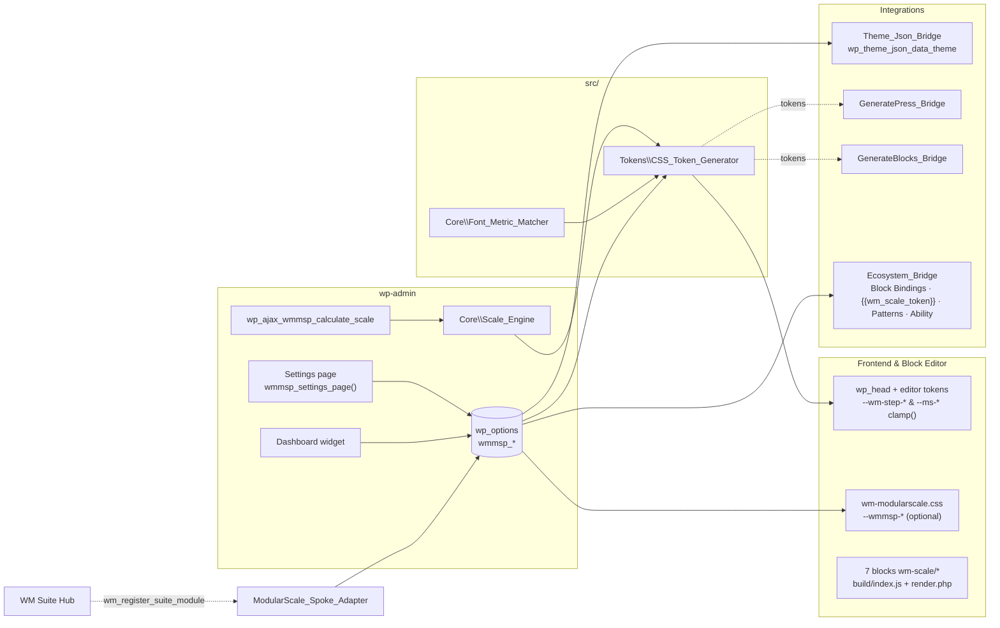

# Architecture — WM Modular Scale

Measured against the code on 2026-11-20 (v1.4.0).

## Runtime



## Responsibilities

| Layer | Owner | Notes |
| --- | --- | --- |
| Math | `Scale_Engine` | steps, ratios (`wm_modularscale_ratios`), clamp slope/intercept, line heights, APCA |
| CSS text | `CSS_Token_Generator`, `Font_Metric_Matcher` | pure functions (`--wm-step-*`, `--ms-*`, `--gp-font-size-*`), filtered by `wm_modularscale_tokens_generated` |
| Delivery | `Plugin` (`wp_head`, inline style), `wmmsp_force_styles()` (legacy sheet) | both gated by `wmmsp_apply_typography` |
| Editor | `Block_Manager` + `build/index.js` + `block.json` + `render.php` | 7 server-rendered blocks in category `wm-scale` with compiled `InspectorControls` and 28 JED `.json` catalogs |
| Theme & Ecosystem bridges | `Theme_Json_Bridge`, `GeneratePress_Bridge`, `GenerateBlocks_Bridge`, `Ecosystem_Bridge` | `theme.json` presets, GeneratePress local fonts, GenerateBlocks 1.x/2.x (`{{wm_scale_token}}`), Block Bindings (`wm-modularscale/tokens`), patterns, WP 6.9 Ability (`wm-modularscale/compute-scale`) |
| Admin | main file + `Settings_Controller` | family sheets from `assets/css/`, sandbox script from `assets/js/`, opt-in uninstall toggle |
| Hub | `includes/class-modularscale-spoke-adapter.php` | CycloneDX 1.6 SBOM, telemetry, actions |

## Persistence

Eleven `wmmsp_*` options (see DEVELOPERS.md §2). No custom tables, no transients, no post meta. `uninstall.php` preserves all options by default and deletes them only when `wmmsp_delete_data_on_uninstall` is enabled.

## Fragile spots

- The settings group (`wmmsp_settings_group`) must hold only fields the page posts: `options.php` writes null for every option of the group the form does not carry. `Plugin::scale_options()` is the single validated reader (`wm_modularscale_scale_options`); read the scale through it, not raw `get_option()`.
- `wmmsp_apply_typography` defaults to 1 for the fluid tokens and 0 for the legacy sheet.
- The sandbox math in `assets/js/modularscale-admin.js` mirrors `wmmsp_force_styles()` (base × ratio^n, pinned by `tests/sandbox.test.ts` and test 14); the fluid tokens use `Scale_Engine::derive_clamp()` with min/max base sizes.
- Every `render.php` and `build/index.asset.php` must keep its `ABSPATH` guard and `declare(strict_types=1);` inside PHP (`tests/test-suite.php` checks all blocks).

## Gates

`php tests/test-suite.php` · `php tests/test-ui-family.php` (6) · `php tests/test-pot-freshness.php` (6) · `bash tests/run-mutations.sh` · `npm run build && npm test && npm run lint` · `python3 .github/scripts/security-audit.py`.

---

---

<!-- wm-measured-inventory -->

## Measured inventory

Regenerated from the code, never hand-edited. Everything above this line is written by hand and stays.

```bash
python3 the fleet's architecture inventory tool wm-modularscale --append-to docs/ARCHITECTURE.md
```

## Inventory by layer

**21 PHP files, 2815 lines** (excluding `tests/`, `vendor/`, `node_modules/`, `languages/`).

| Layer | Files | Lines |
|---|---:|---:|
| `(raíz)` | 2 | 493 |
| `build` | 1 | 16 |
| `includes` | 1 | 145 |
| `src` | 1 | 186 |
| `src/Admin` | 1 | 180 |
| `src/Core` | 2 | 459 |
| `src/Gutenberg` | 8 | 504 |
| `src/Integration` | 4 | 636 |
| `src/Tokens` | 1 | 196 |

---

## Classes

| Class | File |
|---|---|
| `Block_Manager` | [`src/Gutenberg/Block_Manager.php`](../src/Gutenberg/Block_Manager.php) |
| `CSS_Token_Generator` | [`src/Tokens/CSS_Token_Generator.php`](../src/Tokens/CSS_Token_Generator.php) |
| `Ecosystem_Bridge` | [`src/Integration/Ecosystem_Bridge.php`](../src/Integration/Ecosystem_Bridge.php) |
| `Font_Metric_Matcher` | [`src/Core/Font_Metric_Matcher.php`](../src/Core/Font_Metric_Matcher.php) |
| `GenerateBlocks_Bridge` | [`src/Integration/GenerateBlocks_Bridge.php`](../src/Integration/GenerateBlocks_Bridge.php) |
| `GeneratePress_Bridge` | [`src/Integration/GeneratePress_Bridge.php`](../src/Integration/GeneratePress_Bridge.php) |
| `ModularScale_Spoke_Adapter` | [`includes/class-modularscale-spoke-adapter.php`](../includes/class-modularscale-spoke-adapter.php) |
| `Plugin` | [`src/Plugin.php`](../src/Plugin.php) |
| `Scale_Engine` | [`src/Core/Scale_Engine.php`](../src/Core/Scale_Engine.php) |
| `Settings_Controller` | [`src/Admin/Settings_Controller.php`](../src/Admin/Settings_Controller.php) |
| `Theme_Json_Bridge` | [`src/Integration/Theme_Json_Bridge.php`](../src/Integration/Theme_Json_Bridge.php) |

---

## Entry points

**Gutenberg blocks:** `wm-scale/contrast-matrix-badge`, `wm-scale/fluid-container`, `wm-scale/fluid-heading`, `wm-scale/fluid-lead`, `wm-scale/ratio-visualizer`, `wm-scale/theme-json-exporter`, `wm-scale/typographic-grid`

**AJAX actions:** `wmmsp_calculate_scale`

---

## Persistence — who writes each key and who reads it

| Key | Written by | Read by |
|---|---|---|
| `wmmsp_apply_typography` | `src/Admin/Settings_Controller.php` | `includes/class-modularscale-spoke-adapter.php`, `src/Plugin.php`, `wm-modularscale.php` |
| `wmmsp_base_size` | `src/Admin/Settings_Controller.php` | `includes/class-modularscale-spoke-adapter.php`, `wm-modularscale.php` |
| `wmmsp_base_size_max` | `src/Admin/Settings_Controller.php` | — |
| `wmmsp_delete_data_on_uninstall` | `src/Admin/Settings_Controller.php` | `uninstall.php`, `wm-modularscale.php` |
| `wmmsp_font_override_preset` | `src/Admin/Settings_Controller.php` | `src/Plugin.php` |
| `wmmsp_max_viewport` | `src/Admin/Settings_Controller.php` | — |
| `wmmsp_min_viewport` | `src/Admin/Settings_Controller.php` | — |
| `wmmsp_precision` | `src/Admin/Settings_Controller.php` | `includes/class-modularscale-spoke-adapter.php`, `wm-modularscale.php` |
| `wmmsp_ratio` | `src/Admin/Settings_Controller.php` | `includes/class-modularscale-spoke-adapter.php`, `wm-modularscale.php` |
| `wmmsp_ratio_name` | `src/Admin/Settings_Controller.php` | — |
| `wmmsp_unit` | `src/Admin/Settings_Controller.php` | `includes/class-modularscale-spoke-adapter.php`, `wm-modularscale.php` |

Every key has exactly one writing layer and at least one reader.


---

## Gates

- `tests/blocks-editor.test.ts`
- `tests/mutations.php`
- `tests/run-mutations.sh`
- `tests/sandbox.test.ts`
- `tests/scale-engine.test.ts`
- `tests/setup.ts`
- `tests/test-modularscale.php`
- `tests/test-pot-freshness.php`
- `tests/test-settings-save-runtime.php`
- `tests/test-suite.php`
- `tests/test-ui-family.php`
- `.github/workflows/ci.yml`

What CI actually runs is in the workflow files above — a test file that no workflow invokes is not a gate.

---

## Drift detected against the documentation

Nothing measurable: versions agree and every class named in the documents exists.

