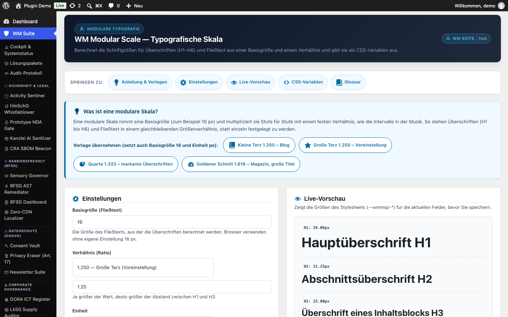

# WM Modular Scale (Hrvatski)

  [🇧🇬 Български](README.bg.md) • [🇨🇿 Čeština](README.cs.md) • [🇩🇰 Dansk](README.da.md) • [🇩🇪 Deutsch](../../README.de.md) • [🇬🇷 Ελληνικά](README.el.md) • [🇬🇧 English](../../README.md) • [🇪🇸 Español](../../README.es.md) • [🇪🇪 Eesti](README.et.md) • [🇫🇮 Suomi](README.fi.md) • [🇫🇷 Français](README.fr.md) • [🇮🇪 Gaeilge](README.ga.md) • [🇭🇷 Hrvatski](README.hr.md) [🇭🇺 Magyar](README.hu.md) • [🇮🇹 Italiano](README.it.md) • [🇱🇹 Lietuvių](README.lt.md) • [🇱🇻 Latviešu](README.lv.md) • [🇲🇹 Malti](README.mt.md) • [🇳🇱 Nederlands](README.nl.md) • [🇵🇱 Polski](README.pl.md) • [🇵🇹 Português](README.pt.md) • [🇷🇴 Română](README.ro.md) • [🇸🇰 Slovenčina](README.sk.md) • [🇸🇮 Slovenščina](README.sl.md) • [🇸🇪 Svenska](README.sv.md)

---

  
  
  
  
  

> **Typographic scale calculator, fluid `clamp()` token generator and Gutenberg / GeneratePress / GenerateBlocks typography bridge for WordPress**  
> **Stranica dodatka:** [https://arnoldwender.com/en/wordpress-plugins/wm-modularscale/](https://arnoldwender.com/en/wordpress-plugins/wm-modularscale/)  
> **Razvijeno agentnim tijekom rada:** izrađeno pomoću AI agenata za programiranje. Prije korištenja u produkciji pregledajte ga i testirajte kao svaki kod trećih strana.  
> **Support & Liability:** Zero support — reproducible bugs on [GitHub Issues](https://github.com/arnoldwender/wm-wp-modularscale/issues) only · no private support · AS IS / no liability ([SUPPORT.md](../../SUPPORT.md))

---

## 📸 Hrvatski Enterprise Showcase

!WM Modular Scale Banner

---

## 🟢 RAZINA 1: VODIČ ZA BRZI POČETAK ZA POČETNIKE (NO-CODE)

### Što ovaj dodatak radi za vašu web stranicu?
Typographic scale calculator, fluid `clamp()` token generator and Gutenberg / GeneratePress / GenerateBlocks typography bridge for WordPress

### 🚀 Kako započeti u 2 minute (Korak po korak):
1. Install and activate the plugin (WordPress 6.4+, PHP 8.1+).
2. Open **Modular Scale** in the admin menu (**WM Suite › Modular Scale** with the hub).
3. Pick a ratio preset or type one, set base size, unit and precision, watch the sandbox, tick *Skala auf der Website anwenden* (translated automatically across all 28 bundled UI locales), save.
4. In the editor, insert any of the seven blocks from the *WM Modular Scale* category (with full sidebar `InspectorControls`), apply the bundled block patterns, bind Core paragraphs/headings via `wm-modularscale/tokens`, or use `{{wm_scale_token}}` and `--ms-*` / `--wm-step-*` in GenerateBlocks.

### 💡 Često postavljana pitanja za početnike:
#### ❓ What is not included?
No WP-CLI commands, no REST endpoints, no shortcodes, no custom database tables, no audit log or export, no external requests.

---

## 🟡 RAZINA 2: VODIČ ZA WEBMASTERE I ADMINISTRATORE

### What the plugin does
1. **Calculates a modular scale.** One base size, one ratio (Major Second 1.125 … Golden Ratio 1.618, or a custom value, filterable via `wm_modularscale_ratios`), nine steps from −2 (micro caption) to +6 (hero) — `ArnoldWender\ModularScale\Core\Scale_Engine`.
2. **Prints fluid CSS tokens into `<head>`** when *apply to the site* is on: `@property` declarations and a `:root` block with `--wm-step-neg-2 … --wm-step-6` and `--ms-neg-2 … --ms-6` (`--ms-0 … --ms-6`) as `clamp(min, preferred, max)` between the configured viewports (default 360 px → 1440 px), matching `--wm-lh-*` line heights, semantic aliases (`--wm-font-size-h1 … body`) and GeneratePress aliases (`--gp-font-size-*`), plus the utility classes `.has-fluid-h1-font-size … .has-fluid-body-font-size` and `.wm-fluid-container` (container queries). Each step is checked against WCAG 1.4.4 zoom safety (max ≤ 2.5 × min). Optional anti-CLS `@font-face` fallback override (Inter → Arial, Roboto → Arial, Merriweather → Georgia, Playfair → Times).
3. **Optional legacy sheet.** The settings page's *apply* toggle also enqueues `wm-modularscale.css`, which sizes `body`, `h1`–`h6`, `p`/lists from `--wmmsp-*` variables computed from base, ratio, unit and precision. No viewport rule shrinks the configured base size (default 16 px); the plugin does not enforce a minimum, the field accepts any value from 1.
4. **Seven Gutenberg blocks with compiled editor sidebar controls (`build/index.js`)** in the "WM Modular Scale" category — each one with its slug, `InspectorControls`, attributes and defaults in **[docs/BLOCKS.md](../../docs/BLOCKS.md)** (`wm-scale/*`): Fluid Heading, Fluid Lead Text, Fluid Container (`@container`), Typographic Grid (CSS grid with a scale gap), Ratio Visualizer (the nine steps drawn at their sizes, with dark/light theme and step-card toggle), APCA Contrast Badge (Lc of a colour pair per apca-w3 0.1.9 with target role selector; APCA is not part of WCAG), Theme.json Exporter (selectable `both`, `json`, or `tailwind` output).
5. **theme.json bridge.** Filters `wp_theme_json_data_theme`: `settings.typography.fontSizes` become the nine fluid steps (`wm-step-neg-2 … wm-step-6`), `defaultFontSizes: false`, `fluid: true`.
6. **GeneratePress bridge.** Empties the Google Fonts list and hides it in the Font Manager, dequeues `generate-fonts`, appends `--gp-font-size-*` plus `h1`–`h6` rules to GeneratePress' dynamic typography CSS, and lists Inter, Outfit, Cinzel, Cabinet Grotesk and a system stack in the font pickers (the plugin ships no font files; those names resolve only if the site provides them).
7. **GenerateBlocks 1.x & 2.x + WordPress 6.5–6.9 ecosystem bridges.** Global styles `wm-fluid-h1/h2/h3/body`, typography presets `wm-step-0 … 6`, `container-type: inline-size` on Container blocks with `useContainerQueries`, a GenerateBlocks 2.x Dynamic Tag `{{wm_scale_token}}` (`GenerateBlocks_Register_Dynamic_Tag`), a WordPress 6.5+ Block Bindings source `wm-modularscale/tokens`, two block patterns (`wm-modularscale/typographic-specimen` and `wm-modularscale/gb-fluid-hero`), and a WordPress 6.9 Ability (`wm-modularscale/compute-scale`) in `ArnoldWender\ModularScale\Integration\Ecosystem_Bridge`.
8. **Admin & opt-in uninstall.** Settings page (menu *Modular Scale*, or under *WM Suite* when the hub is active; also *Settings › Modular Scale*) with a live sandbox preview, one-click ratio presets, and an opt-in checkbox (`wmmsp_delete_data_on_uninstall`, default off) controlling whether `uninstall.php` deletes stored options; plus a dashboard widget with the configured base, ratio and apply state. Both render from the WM Suite admin family sheets.
9. **WM Suite Hub spoke.** `includes/class-modularscale-spoke-adapter.php` registers through `wm_register_suite_module`: CycloneDX 1.6 SBOM entry with the SHA-256 of the main file, telemetry (base size, ratio, applied, H1–H3 tokens) and the `self_test` / `calculate_scale` actions. Also ships a standalone `bom.json` and `.wordpress-org/blueprints/blueprint.json` for WordPress Playground.

### Not shipped
No WP-CLI commands, no REST endpoints, no shortcodes, no custom database tables, no audit log or export, no external requests.

---

## 🔴 RAZINA 3: VODIČ ZA PROGRAMERE I SOFTVERSKE ARHITEKTE

Classes, hooks, options, the admin screen and the WM Suite Hub adapter are documented in the English manual: **[DEVELOPERS.md](../../DEVELOPERS.md)**.

---

## ⚖️ Europska zakonska regulativa i usklađenost

- **Zero external requests:** no CDN, no Google Fonts (the GeneratePress bridge removes them), no telemetry to third parties.
- **Accessibility:** the configured base size (default 16 px) holds on every viewport, every fluid step is checked against WCAG 1.4.4 zoom (max ≤ 2.5 × min), the APCA badge shows the Lc of a colour pair against the selected target role. No conformity with WCAG or the BFSG is claimed.
- **Privacy:** no personal data is processed; the plugin reads and writes its own options only, and preserves them on uninstall unless the administrator explicitly opts in to deletion.

---

## 🔒 Licenca i vlasnička prava

Distributed under the **GNU General Public License v2 or later**.  
Copyright (C) 2026 Arnold Wender.  
